# MeteoPlaneRadar (Tactical & Precipitation Weather Radar for ESP32-S3)


**Multifunctional weather station, live ADS-B flight radar, animated precipitation radar (SHMÚ, ČHMÚ, RainViewer), combined tactical radar, ISS orbit tracking, YouTube channel analytics, financial market tickers, Klipper 3D printer telemetry HUD, disaster warning system with hardware seismometer, and an animated virtual pet companion on a round 2.1" IPS touchscreen.**  
Designed for the **Waveshare ESP32-S3-Touch-LCD-2.1** with smartphone-like touch gestures, a pull-down Control Center, live aircraft photos, bilinear radar smoothing, and an industrial web dashboard.

> 🇸🇰 Slovenská dokumentácia: **[README_SK.md](README_SK.md)** · 📋 Release history: **[CHANGELOG.md](CHANGELOG.md)**  
> 🔄 Forked and significantly enhanced from **[petus/MeteoPlaneRadar](https://github.com/petus/MeteoPlaneRadar)**.

*If you enjoy this project, please consider supporting its development!* ☕  
<a href="https://buymeacoffee.com/hackra" target="_blank"></a>

---

## 📸 Live Device Demo

<p align="center">
  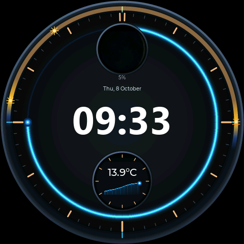
  
  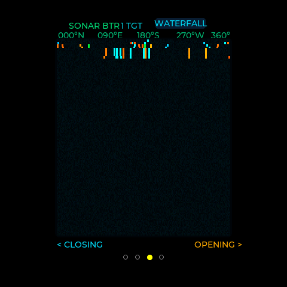
  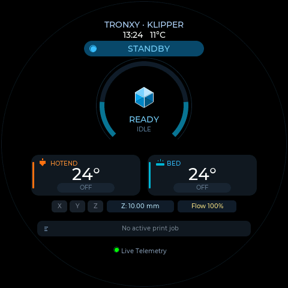
  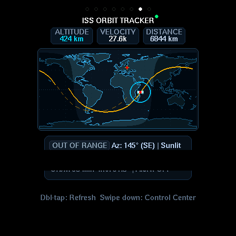
  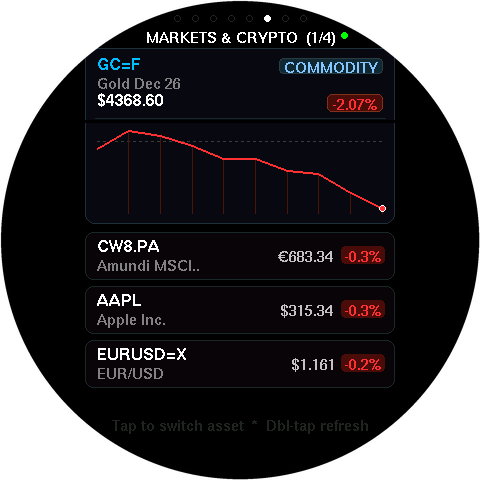
  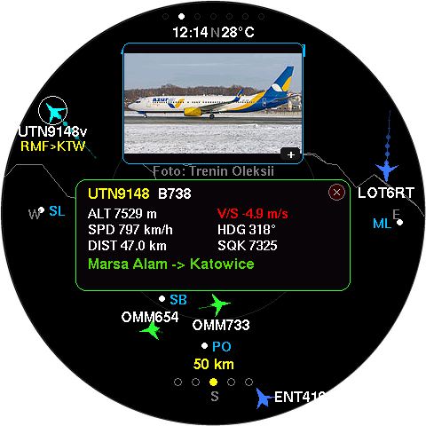
</p>

### 🐱 DigiCat — Animated Virtual Pet Companion

<p align="center">
  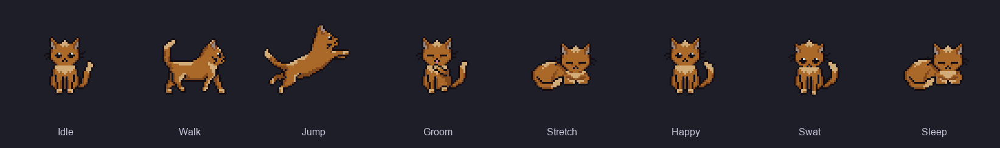
</p>

<p align="center">
  <em>64×64 ginger cat sprites (247 frames, 38 animation sequences, RGB565 PROGMEM, rendered at 3× scale / 192×192 px).</em>
</p>

---

## 🌟 Features

### 🕒 Luxury Astronomical Chronograph & Complications
- **24-Hour Solar Twilight Arc**: Outer perimeter ring displaying real-time solar progression (Noon at 12 o'clock, Midnight at 6 o'clock), astronomical sunrise/sunset markers, golden hour bands, and a live orbiting Sun glyph.
- **Configurable Dual Subdial Complications**: Independent Top and Bottom circular subdial apertures with 7 interchangeable modules:
  - **3D Photorealistic Moon Phase**: Embedded 92×92 NASA LROC lunar texture with analytical 3D Lambertian lighting, accurate northern-hemisphere waxing/waning illumination, and illumination percentage.
  - **Temperature Trend & Sparkline (24h)**: Outdoor temperature with a 24-hour area sparkline curve.
  - **Current Weather & Condition Icon**: Real-time condition glyph, temperature, and wind speed.
  - **Live Telemetry Counters**: ADS-B aircraft within 10 km, YouTube subscriber count, Primary Market ticker, or Klipper 3D printer progress (real-time live polling without leaving the Clock screen).
- **Interactive Navigation**: Tapping either subdial aperture or floating alert banner (overhead flight / approaching rain) jumps directly to its dedicated screen.
- **Dynamic Seconds Orbit**: Smooth ~30 FPS orbiting luminous bead with a trailing Gaussian bloom arc and anti-aliased 76 px Swiss digital typography.
- **DigiCat Cameo**: Ambient peek-in cameo resting on the lower bezel with synchronized breathing.

### 🛩️ ADS-B Flight Radar & Aero Glass HUD
- **360° Airspace Radar (14–200 km)**: Live aircraft tracking via `adsb.fi` / `adsb.lol` with range rings, airport beacons, online map tile underlays, and a 360° aviation compass rose bezel.
- **Glass Cockpit Symbology**: Switchable aerodynamic vector chevrons (with combat jet double-chevrons) or aircraft silhouettes, 1-minute forward velocity vectors, and decluttered 3-line avionics data tags.
- **Special Flight & Squawk Alerts**: Color-coded highlights for Rescue (green), VIP/Government (gold), Heavy jets (cyan), and Military (red), plus automatic target lock and acoustic alert on emergency squawks (`7500` / `7600` / `7700`).
- **Offline Route Database**: Instant callsign-to-route decoding (`ORIG→DEST`) and proximity vector to the nearest aircraft.
- **Live Aircraft Photos & Flight Deck HUD**: Tap any aircraft to view its telemetry card and live photo (baseline & progressive JPEG decoding from Planespotters.net); tap the photo for a full-screen Aero Glass Flight Deck HUD.

### 🌧️ Precipitation Radar, Tactical Overlay & Acoustic Sonar
- **Animated Weather Radar**: Smooth multi-frame radar loops from **SHMÚ**, **ČHMÚ**, or **RainViewer** with temporal cross-dissolve blending and circular masking.
- **TREC 2D Rain Nowcasting**: Vector storm tracking that alerts only when precipitation is actively heading toward your coordinates (ETA ≤ 35 min, miss distance ≤ 6 km), with automatic Rain / Sleet / Snow / Hail classification.
- **Combined Tactical Radar**: Simultaneous precipitation radar underlay + live ADS-B flight radar on a single unified scope.
- **Tactical Acoustic Sonar**: 25 FPS CRT phosphor sweep, Bearing-Time Recorder (BTR) waterfall spectrogram, Doppler velocity encoding, and optional acoustic contact pings.

### 🌤️ Weather Forecast, Air Quality & Night Mode
- **Multi-Day & Hourly Forecast**: Hourly temperature, wind, and precipitation curves plus a 3-day outlook via Open-Meteo.
- **Environmental Telemetry**: European AQI, PM2.5 particulate concentration, and allergen pollen indices (Alder, Birch, Grass, Mugwort, Ragweed).
- **Deep-Red Night Mode**: Automatic solar or scheduled night mode (0.5% ultra-dim red phosphor palette) with optional `nightClockOnly` lock during sleep hours.

### 🛰️ 3D ISS Tracker, Financial Markets & YouTube Analytics
- **3D ISS Orbit Tracker**: Orthographic 3D Earth globe with atmospheric Rayleigh limb glow, real-time solar terminator Day/Night shading, ground track prediction, and 3 view modes (`3D ISS`, `3D Home`, `2D Map`).
- **Financial Markets & Crypto**: Up to 8 configurable Yahoo Finance tickers (stocks, ETFs, crypto, commodities, forex) with sparkline and candlestick charts.
- **YouTube Channel Analytics**: Live subscriber count, total views, and latest/top video performance via non-blocking background streaming.

### 🖨️ Klipper / Moonraker 3D Printer HUD
- **Dedicated Circular Printer HUD**: Real-time LAN telemetry from Moonraker with hardware-rendered vector micro-icons (isometric 3D cube, nozzle, heated bed, homing crosshairs, bed mesh).
- **16 Operational States**: Color-coded LED state detection (`STANDBY`, `HOMING`, `PROBING / MESH`, `HEATING`, `PRINTING`, `PAUSED`, `FILAMENT RUNOUT`, `COMPLETED`, `ERROR`, etc.) with macro lifecycle gating.
- **Thermal & Layer Telemetry**: Dual hotend/heatbed temperature cards with target badges, X/Y/Z homing status, Z-elevation, current/total layer counter (`L X/Y`), and smart print ETA calculation.
- **Strict Network Isolation**: Fast LAN timeouts (1.5 s connect) and mDNS `.local` resolution with non-blocking priority scheduling.

### 🐾 DigiCat — Interactive Virtual Pet Companion
- **Hi-Res Sprite Engine**: 247 frames across 38 animation sequences rendered at 3× scale (`192×192 px`) in a pull-up drawer.
- **Laser Pointer Chase Mode**: Interactive laser dot targeting via touchscreen with realistic feline pouncing, stalking physics, and real-time inverse kinematics tracking.
- **Fish Treat Toss Mini-Game**: Realistic parabolic ballistic trajectory physics, floor bouncing, and eating animation sequences with happiness rewards.
- **Multi-Zone Tactile Petting**: Context-sensitive touch zones (chin scratching, ear rubs, belly tickling, tail swish) triggering dynamic mood shifts, purring audio chimes, and playful sprite reactions.
- **Living Ambient Ecosystem**: Procedural environmental background life including fluttering butterflies, gliding birds, swirling autumn leaves, and floating atmospheric dust motes.
- **Typewriter Dialogue Engine**: Retro word-wrapped animated character-by-character dialogue rendering with conversational AI thoughts from Gemini.
- **Aero-Cat Co-Pilot Mode**: Tap forehead to toggle Top Gun intercept mode with gold aviator sunglasses, mini radar scope, and live 6-axis IMU attitude telemetry (`PITCH`, `ROLL`, `HEADING`).
- **Weather & Airspace Reactivity**: Equips umbrella in rain, scarf in snow/cold, or goggles in clear skies; sprints and swats at live jets passing overhead.
- **Autonomous AI & Gemini Commentary**: Rich idle behaviors, sleep cycles, Hunger/Happiness stats, aviation XP ranks, and optional Google Gemini Flash live air traffic commentary (with 100% offline fallback in EN/SK/CZ).

### 🎛️ Web Portal, Custom Screen Sequence & System Architecture
- **Tactile Field Instrument Web Dashboard**: Responsive Gzip-compressed portal featuring a live 480×480 virtual device mirror with touch simulation, real-time CRT radar simulator, 64 KB PSRAM serial monitor, and OTA firmware updates.
- **Custom Screen Ordering**: Drag-and-drop and step-button sequence manager persisted in NVS—controls touch swipe order, auto-rotation sequence, and web remote navigation.
- **Dual-Core FreeRTOS & Anti-Tearing Display**: Core 1 dedicated to 60 FPS LVGL v9 rendering (with ST7701 RGB bounce buffering to eliminate PSRAM bus tearing) and touch gestures; Core 0 dedicated to asynchronous TLS networking and image decoding.
- **Hardware Seismometer & Disaster Alerts**: Continuous QMI8658 IMU vibration monitoring paired with USGS real-time earthquake and tsunami feeds.

---

## 📱 Screen Overview

| Screen | Preview | Description | Source |
| :--- | :---: | :--- | :--- |
| **0. Clock** |  | Luxury Astronomical Chronograph (24h solar arc, dual complications) | Open-Meteo / RTC |
| **1. Planes** | 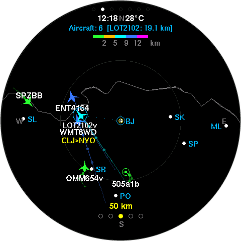 | Glass Cockpit ADS-B radar, 360° compass rose, velocity vectors, map tiles | adsb.fi / adsb.lol |
| **1b. Aircraft Detail** |  | Aero Glass Flight Deck HUD with full telemetry + live aircraft photo | Planespotters.net |
| **2. Weather Radar** |  | Animated radar loop, cross-dissolve blending, TREC rain nowcasting | SHMÚ / ČHMÚ / RainViewer |
| **3. Tactical Radar** |  | Precipitation radar + live ADS-B overlay with glass cockpit styling | SHMÚ / ČHMÚ + adsb.fi |
| **4. Sonar** |  | CRT phosphor radar sweep, BTR waterfall spectrogram, Doppler velocity | adsb.fi |
| **5. Forecast** | 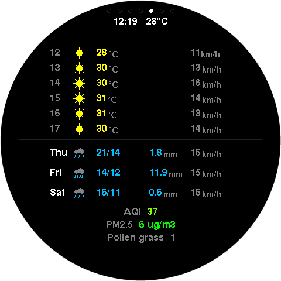 | Hourly curves, 3-day forecast, AQI, PM2.5, pollen | Open-Meteo |
| **6. Markets & Crypto** |  | Up to 8 custom tickers, sparkline & candlestick charts | Yahoo Finance v8 |
| **7. ISS Tracker** |  | 3D orthographic Earth globe, solar terminator, Rayleigh limb glow, orbits | WhereTheISS API |
| **8. YouTube** | 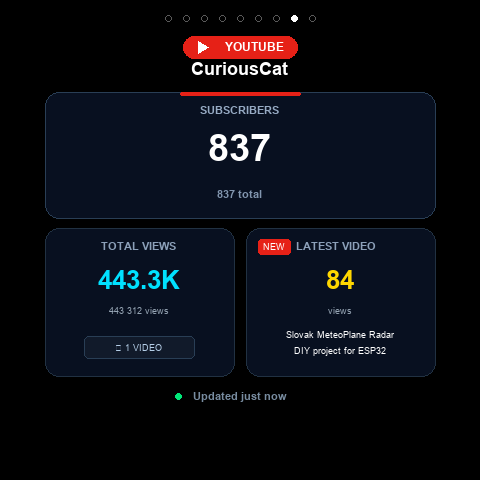 | Subscriber count, total views, latest / top video stats | YouTube Data API v3 |
| **9. 3D Printer (Klipper)** |  | Live Klipper telemetry HUD, nozzle/bed temps, layer progress, ETA | Moonraker API |
| **10. Flight Stats & Info** | 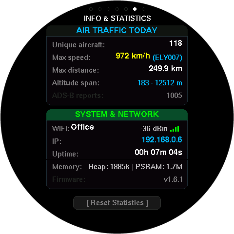 | 24h airspace activity across 6 zoom scopes, SRAM & PSRAM telemetry | PSRAM Tracker |
| **11. Settings** | 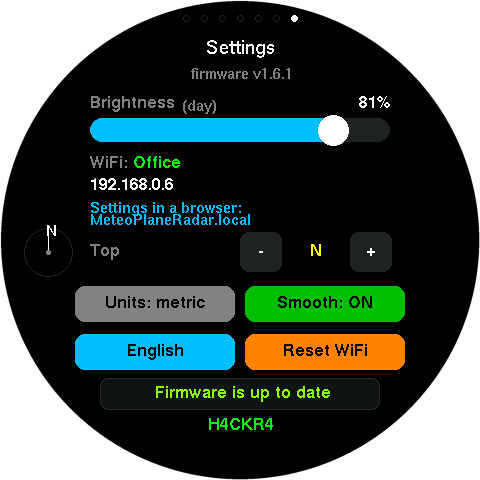 | Device telemetry, IP, brightness, language, map provider, audio, OTA | System |

---

## 🖐️ Gestures & Touch Controls

| Gesture | Action |
| :--- | :--- |
| **Swipe Left / Right** | Previous / next screen (follows custom user sequence) |
| **Pull Down from top edge** | Quick Control Center (brightness, complications, night mode, trails, map provider) |
| **Swipe Up from bottom edge** | Open DigiCat companion drawer |
| **Tap right flank zone (Radars)** | Reveal floating `+` / `-` zoom buttons (auto-hide after 3.5 s) |
| **Tap top / bottom subdial (Clock)** | Jump directly to the complication's full telemetry screen |
| **Tap alert banner (Clock)** | Jump to Planes (overhead flight) or Weather Radar (rain alert) |
| **Tap aircraft blip** | Open telemetry detail card with live photo |
| **Tap aircraft photo** | Open full-screen Aero Glass Flight Deck HUD (tap to return) |
| **Double-tap screen (Radars)** | Toggle clean map mode (hide / show legends & labels) |
| **Tap top-right badge / range pill (Sonar)** | Cycle sonar view mode (`Classic PPI` → `Split` → `Waterfall`) / range (`25–150 km`) |
| **Tap Earth globe (ISS)** | Cycle ISS view mode (`3D ISS` → `3D Home` → `2D Map`) |
| **Tap screen (Klipper)** | Trigger immediate Moonraker telemetry refresh |
| **Tap / Double-tap pet (DigiCat)** | Pet affection (tap forehead for Top Gun mode) / feed treat |
| **Hold BOOT button ~3 s** | Factory reset (clears Wi-Fi & NVS settings) |

---

## 🔧 Hardware Specifications

Built for the **[Waveshare ESP32-S3-Touch-LCD-2.1](https://www.waveshare.com/esp32-s3-touch-lcd-2.1.htm)**:

| Component | Specification |
| :--- | :--- |
| **MCU** | ESP32-S3R8 · Dual-Core LX7 @ 240 MHz |
| **Memory** | 8 MB Octal PSRAM + 16 MB Quad SPI Flash |
| **Display** | Round 2.1" IPS · 480×480 px · ST7701 RGB |
| **Touch** | CST820 / CHSC6540 Capacitive (I2C) |
| **IMU** | QMI8658 6-axis Accelerometer + Gyroscope |
| **RTC** | PCF85063 (I2C `0x51`) with optional supercapacitor backup |
| **Connectivity** | USB-C · Wi-Fi 802.11 b/g/n 2.4 GHz |

---

## 🚀 Installation

### Method A — Pre-built Binary (Easiest)
Download from **[Releases](https://github.com/hackra76/ESP-MeteoPlaneRadar/releases)**:
- `MeteoPlaneRadar-v3.9.0-factory.bin` — full image (bootloader + partitions + firmware).
- Flash via [ESP Web Flasher](https://espressif.github.io/esptool-js/) at `921600` baud, address `0x00000000`.
- Or via CLI:
  ```bash
  esptool.py -p COM_PORT -b 921600 write_flash 0x0 MeteoPlaneRadar-v3.9.0-factory.bin
  ```

### Method B — PlatformIO
```bash
pio run            # build
pio run -t upload  # flash
```

### First Boot & Wi-Fi Setup
1. Device creates an open AP **`MeteoPlaneRadar`** and displays a QR code on screen.
2. Connect to the AP → open `http://192.168.4.1/` → enter your Wi-Fi credentials → **Save**.
3. Access the web dashboard at **`http://meteoplaneradar.local/`** (or device IP).

---

## 🔑 YouTube Data API Key Setup

1. Create a project in the [Google Cloud Console](https://console.cloud.google.com/).
2. Enable **YouTube Data API v3** and create an **API Key** (*APIs & Services → Credentials*).
3. In the device web dashboard → **YouTube** tab → paste your API Key and channel handle (`@name`) or Channel ID (`UC...`).

---

## 🌐 REST API

| Endpoint | Method | Description |
| :--- | :---: | :--- |
| `/api/status` | `GET` | Full JSON telemetry (weather, aircraft, heap, PSRAM, ISS) |
| `/api/hardware` | `GET` | Peripherals, RTC, I2C scan, reset reason |
| `/api/screen` | `POST` | Switch screen (`{"index": 0}` or `{"step": 1}`) |
| `/api/screenshot.bmp` | `GET` | Live 480×480 24-bit BMP screen capture |
| `/api/display/resync` | `POST` | Force ST7701 RGB panel hardware resync |
| `/api/toggle-legends` | `POST` | Toggle clean map mode on radar screens |
| `/api/rtc/sync_ntp` | `POST` | Force NTP → hardware RTC synchronization |

---

## 📜 License & Credits

MIT License.
- Base project: **[petus/MeteoPlaneRadar](https://github.com/petus/MeteoPlaneRadar)**
- DigiCat virtual pet mechanics: **[aquascape123/digicat](https://github.com/aquascape123/digicat)** (MIT)
- Enhancements, SHMÚ radar, ISS tracker, luxury chronograph, touch navigation, DigiCat hi-res sprites, AI pet brain, industrial web dashboard, Slovak localization: **Rado & Antigravity AI**
